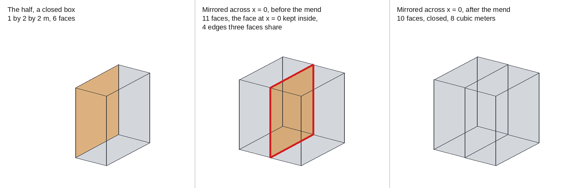
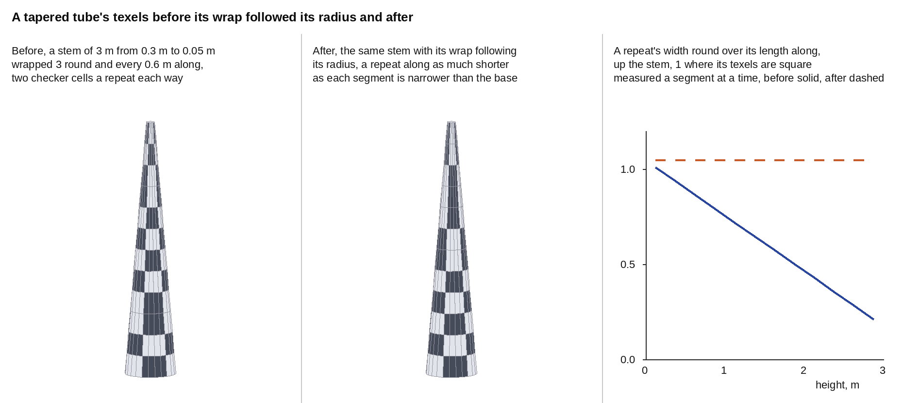
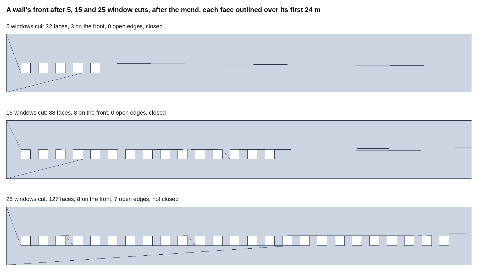
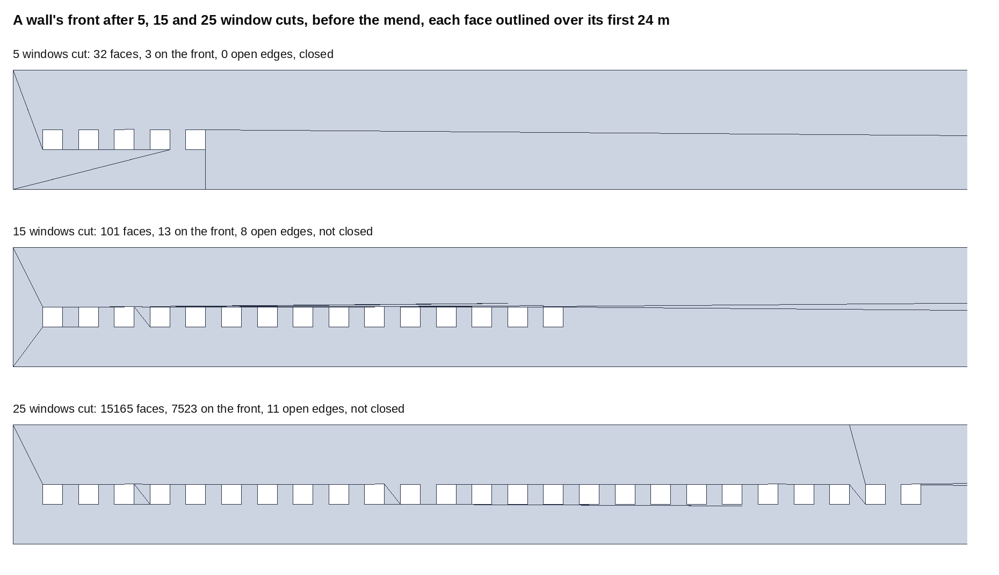

# Modeling devlog

What landed in Modeling, by day and newest first, with the pictures taken on the way, the captures
the repository keeps under `.github/assets` and the pictures made while an item was built, kept
under `.github/assets/readings` as WebP files named by their day, each on the day its name says, and
the notes written beside them as Markdown files named the same way. A line under Done names the item
of .github/REVIEW.md or .github/REVIEW-ARCHIVE.md and the commit that closed it.

## 2026-11-19

How the wall of 200 m's front is cut into triangles as the 25th window's cut meets it, measured by
cutting its front with the recipe's `triangulate`, which follows the rule the cut's partition takes
its triangles by, each triangle's height over its longest side.

| What | Measure |
|---|---|
| Front faces and their corners | 9, of 120, 23, 20, 19, 8, 5, 3, 3 and 3 |
| Triangles ear clipping cuts them into | 186 |
| The thinnest | 1.5e-8 m across a side of 178.6 m |
| Thinner than 1e-4 m, the join's distance | 31 |
| Thinner than 1e-3 m | 39 |
| Thinner than 1e-2 m | 73 |

Ear clipping cuts a face for a cut in `EditMesh.Booleans.cs` where a mesh's faces become the
partition's polygons, and for the build, the triangulation and a solid's own faces elsewhere. The
face of 120 corners reaches round the windows through slits of no width, so its thinnest triangles
lie along a slit, near no area, and the partition skips a triangle by its area alone, 1e-12, which
they pass. Of the two mends the bound is the smaller: the partition's polygons leave out a triangle
thinner than the boolean's epsilon, one test at one line, where convex pieces round each window
would change how the join builds every face a cut makes and the counts the tests pin.

Commits that day

- `e007942` A cut leaves out the triangles thinner than its epsilon that a face cut along a slit
  gives, so a long wall with many windows keeps 3 open edges where it kept 7.
- `36db216` A reading measures how thin the triangles a long wall's slit front is cut into are, the
  drift's cause.
- `f19ca21` A cut reads and stores its points in doubles so none is rounded between two cuts, the
  long wall with many windows still open at its far corners.
- `e2753b6` An edit mesh keeps its points in doubles behind the floats its operations read and
  write, ready for a cut to keep its own as they are.

## 2026-11-18

A closed half box of 1 by 2 by 2 m mirrored across x = 0, before the mend with 11 faces and its face
at x = 0 left inside on four edges three faces share, and after it with 10 faces, closed and holding
8 cubic meters, the faces drawn see-through.

A stem of 3 m tapering from 0.3 to 0.05 m wrapped 3 round and every 0.6 m along, before its wrap
followed its radius with its checker's cells squeezing round it, its width round over its length
along falling from 1.011 to 0.211 a segment at a time, and after, the same stem with the ratio held
at 1.047 the whole way and its cells growing finer toward the tip.

The same wall after the mend, closed with 32 and 88 faces at 5 and 15 windows, and at 25 holding 127
faces with 8 on its front, 7 open edges left where a corner far along the wall drifts by 1.5e-4 m.

A wall of 200 m with 5, 15 and 25 windows cut along its front before the mend, each front face
outlined, closed at 5, open at 15 with 8 open edges, and at 25 holding 15,165 faces, 7,523 of them
slivers on its front along the windows' heads.

Where an edit mesh holds a float between two cuts, read with `grep -c _positions Modeling/EditMesh*.cs`
and `grep -n "(float)" Modeling/EditMesh*.cs`.

| What | Where | Count |
|---|---|---|
| The store of every point, `List<Vector3>` | `EditMesh.cs:63` | 1 |
| Its uses | 14 partial files, the modifiers 22, the topology 18, the mesh 14, the booleans 13, the sweeps 10, the coordinates 9, the bevel 8, the primitives 7, the cuts 7, the transforms 5, the selection 4, the exchange 2, the recipe and the joins 1 each | 155 |
| The partition's points made floats again | `EditMesh.Booleans.cs:220`, once at each cut's end | 1 |
| Sums worked in doubles and stored as floats | `EditMesh.cs:307`, `EditMesh.Topology.cs:447` | 2 |
| Public members giving a point | `Position`, `Center`, `Bounds` | 3 |
| A face's own coordinates and their fit, in floats | `Face.Uvs`, `UvMap` | 2 |

The partition and the joining, `Csg` and `FaceMerge`, work in doubles already, so a cut loses its
precision only where its points are stored back into the one list of floats and read from it by
the next cut. The steps that follow from it, each leaving the suite green, are the 155 uses put
behind two accessors with nothing else changed, the list made one of doubles behind them with the
public members still giving floats, the cut storing the partition's points as they are, and the
skipped wall of 200 m turned on where it then passes.

Commits that day

- `c60e2c7` An edit mesh's points are read and written through a collection of their own, so what
  they are kept in changes in one place.
- `34dc413` A reading counts where an edit mesh holds its points as floats between two cuts, the
  first step toward keeping them in doubles.
- `94bcf46` The build gives each corner's tangent and hand from its texture coordinates, for an
  engine that draws normal maps with a tangent buffer.
- `8347e31` A test holds a long wall with many windows closed, skipped with its reason, since a
  corner far along it still drifts between cuts.
- `2c2884f` A cut leaves out the flaps and slivers its partition made, so a wall with many windows
  keeps a handful of faces for each and stays closed, a wall far longer than its windows' reach
  still drifting at its far corners.
- `2f9af55` A glTF model's materials are read by the Materials module's import in place of the
  reader's own, refusing what glTF does not allow and keeping a picture whose path holds a space.
- `f61e929` A tapered tube's wrap can follow its radius, so its picture's texels keep the shape they
  have at its base the whole way, and the README says how a branch keeps the scale across its joint.
- `1c83492` The Tools submodule is moved to its head and the devlog is written again with each day's
  commits.
- `def69f0` A tube carries its picture so many times round it and so many meters along it as its
  caller states, its line naming the wrap where one is given.
- `a45e5ff` The Tools submodule is moved to its head, the cheatsheet naming each tuple's elements.
- `9a531f3` The carpet's and the wallpaper's albedos are encoded again by the Materials module's
  encoder that writes BC7's mode 1 where a block's colors leave one line, the manifest's errors and
  mean colors following, and the texture test decodes the sets by Materials in place of a decoder of
  its own.
- `eb280e3` The README gives a recipe's lines, its header, comments and words, and every operation's
  line as its command reads it, which a test holds to the commands' usages.
- `b453f0b` Each element of the documentation stands on a line of its own and no line breaks inside
  a tag, where a rewrap had joined them.
- `70033bb` The README tells an engine how its console takes the model commands and its world draws
  what they show, with the rule a line is read by and the count of commands the module holds.
- `8946fd5` The model commands run a line on the models a store keeps by name, each answering its
  text and why it refused, with every usage held to what its command reads.
- `27e1ae6` A glTF material's emission is read as its factor times its strength with no unit, as
  Materials names it.
- `4c6aa15` The cheatsheet is written as one word, and the tests hold the module to the seven checks
  the Tools submodule gives, the README's link row and a text that names no engine among them.
- `6671056` The module names no engine in its documents, tests and scripts, each such line said by
  what it holds or by the module whose format it follows.
- `9d38d40` An imported model keeps its materials' looks as Materials' description, its faces' own
  texture coordinates and the smoothing its normals give, the library taking Materials from a
  checkout beside it or from its own submodule.
- `9258fbd` An edit mesh is written as a glTF file through its files and a glTF is read into one
  with no engine, the files gaining a write of bytes for the buffer beside it.
- `f20cad5` The carpet's and the wallpaper's albedos are encoded again by the Materials module's
  mended BC7 encoder, the other files of both sets unchanged.
- `9ab0d03` The devlog is written again by the Tools script with the mirror's reading on its day,
  the README opens with a link to it, and AGENTS.md names the command that writes it.
- `108092c` The tests take the checks every module keeps from the Tools submodule, and a clone
  without the submodule stops with the command that fetches it.
- `2ada544` The README tells an engine how to bind the module, the interface it implements, the
  conventions it stands on, a knife's plane through the origin where no point is named among them,
  and the smallest binding, which is the tests' host word for word.
- `2d259bf` The tests gain an engine of the smallest kind, its files in memory and its own vertex
  and material, which binds the module and runs a recipe that joins, imports, textures, saves and
  loads through it into meshes a slot.
- `ba89bee` A reading shows a closed half mirrored before and after the mirror's mend, the build's
  budget comment says what the bound guards, and Python's caches are ignored.
- `ba5d12d` The edit mesh gains the tube, the selection of edges, the boolean modifier, a repeated
  smooth and the modifier lines after add, and a mirror takes away a selected face in its plane so a
  closed half mirrored stays closed.
- `70944a5` The library builds as the 3DEngine.Modeling assembly with that package id and its tests
  as 3DEngine.Modeling.Tests, the namespace staying Modeling.

## 2026-11-17

Commits that day

- `163b218` The ignore file's note on the pictures folder names no one, and the guides spell
  canceled.

## 2026-11-01

The carpet's 1K color and normal, whole and with the middle 256 texels enlarged twice, the normal's
slopes slight.

The wallpaper's three scans side by side at one height, the raw scan, scan2 turned straight and
cleaned, and the small final tile, none of them meeting itself at its edges.

The two sets decoded from their KTX2 files, the wallpaper's albedo tiled twice each way at its
repeat's shape of 17.7 by 26.4 cm, the carpet's albedo and normal tiled the same, and the strip at
the wallpaper tile's left edge halfway down enlarged three times, a place whose copies lie only at
the scan's edges.

Done that day

- Item 5 at `883d624`. Interior textures in the module's bounded collection.

Commits that day

- `2abb761` Names build/textures.py in the build folder's row of AGENTS.md's table of areas.
- `883d624` Adds a carpet set and a chevron wallpaper set at 1K under Modeling/Textures as KTX2
  albedo, normal and surface files, built by build/textures.py from their recipes in textures.json,
  with a test that reads each set's files and decodes its channels.

## 2026-10-31

Done that day

- Item 1 at `a7da906`. The documents, one commit.
- Item 2 at `6fb25bb`. The skeleton, one commit after item 1.

Commits that day

- `6fb25bb` The module gains its solution, an empty library whose public members need summaries, a
  test that it loads, the version at 0.1 and a build workflow on Linux, Windows and macOS.
- `a7da906` The module gains its documents, AGENTS.md, the README, STYLE.md, COMMITS.md and the code
  of conduct as the engines keep them, with git's ignore and attribute files.
