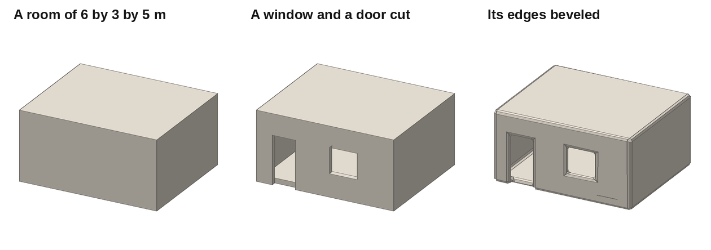

[Devlog](https://github.com/EggyStudio/3DEngine.Modeling/blob/main/DEVLOG.md) [Cheatsheet](https://github.com/EggyStudio/3DEngine.Modeling/blob/main/CHEATSHEET.md)

# Modeling



A room of 6 by 3 by 5 m as the module makes it, then with a window and a door cut through its front wall, then with its edges beveled.

Modeling is a library an engine takes as a git submodule, for the edit mesh shaped by operations
through a selection, its recipes and the `model.*` commands. It references no engine, and an engine
implements the interface it declares where it binds the module.

## What it holds

| Type | Gives |
|---|---|
| `EditMesh` | A polygon mesh shaped by primitives and by operations on its selection, its faces of any count kept whole, its material slots, its modifiers, and its recipe, the line each operation writes, which is its undo and its file and makes the mesh again when it is run |
| `EditMeshBuild` | The mesh with its modifiers applied, built into the vertices and triangles of each slot, with each corner's tangent and hand for an engine that draws with a tangent buffer, each face cut by ear clipping with its own normals and texture coordinates, smoothed within its angle |
| `MeshVertex` and `Bounds` | A built vertex, its place, normal and texture coordinates, which an engine copies into its own, and a box along the axes |
| `SlotGiven` and `MaterialMap` | Which fields of a slot a recipe gave, and the maps of a glTF material a recipe names by their files, the slot's own look being the Materials module's `MaterialDescription` an engine loads into a material of its own |
| `IModelFiles`, `ModelPart` and `ModelFolder` | The files a mesh reads and writes, its recipe's, the recipes its joins name, the model files it imports as placed triangles with their normals, texture coordinates and material's look where the file holds them, its textures' widths and the glTF it is exported as, which an engine implements with its own lookup and model reader, and the files of a folder, which read glTF, for the tests and a program with no engine |
| `SelectionMode` | Whether a selection replaces what was selected, adds to it or takes from it |
| `TubeWrap` | How a tube's texture coordinates carry a picture, how many times round it and how many meters one repeat runs along it |
| `ModelCommands`, `ModelCommand` and `ModelStore` | The model commands, one for each operation of the recipe and those that make, name, read, write, show and forget a model, each a name, a summary, a usage and what runs it, run on the models a store keeps by name, a program's own among them |
| `CommandAnswer` and `CommandFailure` | What a command answers, the text a script reads and why it was refused, as a code a console takes |
| `IModelScene` | What the commands ask of an engine's world, to draw a model at a point and to take away what draws it |

## Taking it into an engine

An engine adds the repository as a git submodule under `modules/` and references its project, here
from a project one folder below the engine's root.

```bash
git submodule add https://github.com/EggyStudio/3DEngine.Modeling.git modules/Modeling
```

```xml
<ProjectReference Include="..\modules\Modeling\Modeling\Modeling.csproj" />
```

A clone of the engine fetches the module with `git clone --recurse-submodules`, or with
`git submodule update --init` in a clone made without it, and a workflow checks it out with
`submodules: true` on `actions/checkout`. A change the engine uses is committed and pushed here
before the engine's commit that moves its pointer, so the engine's history never names a commit
this repository does not have.

## Binding it in your engine

The module shapes a mesh and gives out its data, and an engine draws it, collides with it and loads
its materials. Its assembly is `3DEngine.Modeling`, and its types stand in the namespace `Modeling`.
It opens no window and no graphics device, reads and writes no file but through an interface, and
declares two interfaces for what it needs of an engine.

The library takes the Materials module, whose `MaterialDescription` an imported model's materials
are read as. A Materials checkout beside this one is built where it stands, so a program that takes
both builds one Materials, and this repository's submodule `modules/Materials` is built where none
stands beside it.

| Interface | What the engine answers |
|---|---|
| `IModelFiles` | A text file read and written whole by its path, a recipe's, a file of bytes written whole, a glTF file's and its buffer's, a model file's meshes as triangles placed by the file's nodes, each a `ModelPart`, and an image's width in pixels, which every file a mesh's recipe names is read through |
| `IModelScene` | Drawing a model the commands show at a point in meters, drawing it again as its mesh's `Version` moves, and taking away what draws a model they forget |

A mesh is made with the engine's files, `new EditMesh(files)`, or read with them by
`EditMesh.Load` or `EditMesh.FromRecipe`, and every mesh a join, a boolean or a modifier makes inside
it shares them. `ModelFolder` is an `IModelFiles` over a folder, reading a model file as glTF and
the width of a PNG or a KTX2 from its header. The binding reads what `EditMeshBuild.Slots` gives, a
mesh a material slot of `MeshVertex` corners and uint triangles, and each slot's `MaterialDescription` by
`EditMesh.LookAt`, with `EditMesh.GivenAt` saying which fields a recipe gave, whose maps `MaterialMap` names, and makes meshes and materials of its own.

What the module gives out stands on these conventions.

| Quantity | Convention |
|---|---|
| Length | Meters, the grid's step from a sixteenth of a meter to 64 |
| Axes | Y up and right-handed, as System.Numerics' cross product is, `select +y` picking the faces that face up |
| Triangles | Counterclockwise seen from the side a face faces, each face's corners its own in the build |
| Texture coordinates | A face's corners' places in meters seen along the axis its normal is nearest until a `uv` line gives it its own, the second running down a wall, so a picture's first row is its top |
| Angles | Degrees, a rotation counterclockwise looking back along its axis |
| Color | A slot's color as sRGB numbers from 0 to 1 with its alpha, as a color picker shows them, and its emissive color linear and unitless, as glTF's factor times its strength is, past 1 for a bright light, an imported material's `MaterialDescription` saying so by `EmissiveUnit.Unitless` |
| Paths | One word with forward slashes, as a recipe line holds it, found by the engine's `IModelFiles` |
| A plane or a center with no `at` | Through the origin, for a knife, a mirror, a spin and a modifier's mirror, so an engine whose own lines meant the selection's middle writes the point with `at` |

An engine with Z up or left-handed axes turns the positions and normals it is given, and one that
takes clockwise triangles as their front takes each triangle's corners in the other order. A recipe's
file starts with `model 1` and ends in `.model`.

An engine's console takes the model commands from `ModelCommands`, made over a `ModelStore` of
the engine's files and the engine's `IModelScene`, by registering every `ModelCommand` of
`ModelCommands.All` under its name, its summary and its usage, and running a line with
`ModelCommand.Run` or `ModelCommands.Run`. `ModelCommands.All` holds 57 commands, 11 that make,
name, read, write, show and forget a model and one for each of the recipe's 46 operations, each
answering a `CommandAnswer` whose `Code` a console that names its failures takes as it is. A
program names its own meshes in the store with `ModelStore.Name`, so they answer to the commands.

A line is a command's name and then its words, split at spaces and tabs, with no quoting, since
every name, path and number a command takes is one word, and a number is read in the invariant
culture, a point before its fraction. A usage is the command's name and its words, a word standing
for itself, `<x y z>` taking a word for each name in it, `[...]` left out or not, `(a | b)` taking
one of what it holds, and `...` after a part taking it once or more.

The smallest binding keeps its files in memory, builds a mesh into a mesh of its own for each slot,
copies each slot's look into its material, draws what the commands show and takes every command
into its console.

```csharp
using System.Numerics;
using Materials;
using Modeling;

// The engine's files, kept here in memory by their paths, which every mesh it makes reads and
// writes. An engine on a disk finds them as it finds a program's other files, and its own model
// reader gives a model file's meshes.
public sealed class HostFiles : IModelFiles
{
    private readonly Dictionary<string, string> _texts = [];
    private readonly Dictionary<string, byte[]> _bytes = [];
    private readonly Dictionary<string, IReadOnlyList<ModelPart>> _models = [];
    private readonly Dictionary<string, int> _images = [];

    public void PutText(string path, string text) => _texts[path] = text;

    public void PutModel(string path, IReadOnlyList<ModelPart> parts) => _models[path] = parts;

    public void PutImage(string path, int width) => _images[path] = width;

    public string ReadText(string path) =>
        _texts.TryGetValue(path, out var text) ? text : throw new FileNotFoundException($"There is no file at {path}.", path);

    public string WriteText(string path, string text)
    {
        _texts[path] = text;
        return path;
    }

    public string WriteBytes(string path, byte[] bytes)
    {
        _bytes[path] = bytes;
        return path;
    }

    public byte[] Bytes(string path) => _bytes[path];

    public IReadOnlyList<ModelPart> ReadModel(string path) =>
        _models.TryGetValue(path, out var parts) ? parts : throw new FileNotFoundException($"There is no model at {path}.", path);

    public int? ImageWidth(string path) => _images.TryGetValue(path, out var width) ? width : null;
}

// The engine's vertex, laid out as its renderer reads it, and its material and mesh of a slot.
public readonly record struct HostVertex(Vector3 Position, Vector3 Normal, Vector2 TexCoord);

public sealed record HostMaterial(string Name, Vector4 Color, string? Albedo, string? Normal, Vector3 Emissive);

public sealed record HostMesh(HostVertex[] Vertices, uint[] Indices, HostMaterial Material);

// An edit mesh built into the engine's meshes, one a slot in the order of its slots, each vertex
// copied into the engine's and each slot's look into its material, white where it gives no color.
public static class HostBinding
{
    public static HostMesh[] Build(EditMesh mesh)
    {
        var built = EditMeshBuild.Slots(mesh);
        var meshes = new HostMesh[built.Length];
        for (var slot = 0; slot < built.Length; slot++)
        {
            var (vertices, indices) = built[slot];
            var look = mesh.LookAt(slot);
            var material = new HostMaterial(mesh.Slots[slot], look.BaseColor, look.PictureOf(PictureRole.BaseColor)?.Picture.Path, look.PictureOf(PictureRole.NormalX)?.Picture.Path, look.Emissive);
            meshes[slot] = new HostMesh([.. vertices.Select(v => new HostVertex(v.Position, v.Normal, v.Uv))], indices, material);
        }
        return meshes;
    }
}

// The engine's world, which draws a shown model where it stands and draws it again as its version
// moves, and takes away what draws a forgotten one.
public sealed class HostScene : IModelScene
{
    public Dictionary<string, (EditMesh Mesh, Vector3 At, int Drawn)> Shown { get; } = [];

    public void Show(string name, EditMesh mesh, Vector3 at) => Shown[name] = (mesh, at, mesh.Version);

    public void Forget(string name) => Shown.Remove(name);

    // A frame, which builds a shown model again where its mesh changed since it was drawn.
    public int Draw()
    {
        var built = 0;
        foreach (var (name, (mesh, at, drawn)) in Shown.ToArray())
        {
            if (mesh.Version == drawn) continue;
            HostBinding.Build(mesh);
            Shown[name] = (mesh, at, mesh.Version);
            built++;
        }
        return built;
    }
}

// The engine's console, which takes every model command by its name and its usage, and answers a
// refused line with its code.
public sealed class HostConsole
{
    private readonly Dictionary<string, ModelCommand> _commands = [];

    public HostConsole(ModelCommands commands)
    {
        foreach (var command in commands.All) _commands[command.Name] = command;
    }

    public IEnumerable<string> Help => _commands.Values.Select(command => $"{command.Usage}  {command.Summary}");

    public string Run(string line)
    {
        var name = line.Split(' ', 2)[0];
        if (!_commands.TryGetValue(name, out var command)) return $"NO_SUCH_COMMAND {name}";
        var answer = command.Run(line.Length > name.Length ? line[(name.Length + 1)..] : "");
        return answer.Done ? answer.Text : $"{answer.Code} {answer.Text}";
    }
}
```

## A recipe's lines

A model's recipe is a text file ending in `.model`, whose first line is `model 1`, its form and the
form's version, and then one operation a line, as `EditMesh.Run` takes each and `EditMesh.RecipeText`
writes them. Text after `#` to the line's end is a comment, and a blank line is skipped. A line's
words are split at spaces and tabs with no quoting and its numbers read in the invariant culture, as
a command's are, and each operation acts on the selection the lines before it left, a primitive
selecting what it made. A line is written in the usage grammar of the commands, an operation's
command taking the line after the model's name, and a `<side>` is one of `+x`, `-x`, `+y`, `-y`,
`+z` and `-z`, the faces that face nearest that way.

A color is kept to five places, sRGB's numbers held as linear light and written back to five, so
`model.info` says a color given to seven places at five, while the recipe's own line keeps it as it
was given, and every color of n over 255 comes back the same through a save and a load.

```text
model 1
# a room with a door in its front wall
room 6 3 5 0.2
select +z
cut door 1 2.1 1.5
```

The operations and their lines are these.

- `box <x y z> [at <x y z>] [center]`, adds a box.
- `plane <width> <depth> [at <x y z>] [center]`, adds a plane facing up.
- `cylinder <radius> <height> <sides> [at <x y z>] [center]`, adds a cylinder.
- `cone <radius> <height> <sides> [at <x y z>] [center]`, adds a cone.
- `wedge <x y z> [at <x y z>] [center]`, adds a wedge rising along Z.
- `stairs <steps> <rise> <run> <width> [at <x y z>] [center]`, adds a flight of stairs.
- `arch <radius> <thickness> <depth> <sides> [at <x y z>] [center]`, adds an arch.
- `room <x y z> <thickness> [at <x y z>] [center]`, adds a hollow room.
- `ramp <rise> <run> <width> [at <x y z>] [center]`, adds a ramp rising along Z.
- `tube <sides> [wrap <around> <along> [radius]] (<x y z radius>)...`, adds a tube along a chain of points, round about each by its radius.
- `select (all | none | invert | [(add | remove)] (face (<face>)... | edge (<a b>)... | <side> | box <x0 y0 z0 x1 y1 z1> | slot <slot>))`, selects faces, edges or vertices by what they are or where they lie.
- `move <x y z>`, moves the selection.
- `rotate (x | y | z | <ax ay az>) <degrees> [at <x y z>]`, turns the selection.
- `scale (<factor> | <x y z>) [at <x y z>]`, scales the selection.
- `grid <step>`, sets the grid step.
- `snap`, puts the selection on the grid.
- `material <slot>`, puts the selected faces in a slot.
- `shade (smooth [<degrees>] | flat)`, draws the selected faces smoothed or flat.
- `clear`, empties a model.
- `extrude (<distance> | <x y z>)`, pushes the selected faces out.
- `inset <distance>`, insets each selected face.
- `delete [fill]`, takes away the selection.
- `merge <distance>`, joins the selected vertices within a distance.
- `flip`, turns the selected faces the other way.
- `triangulate`, cuts the selected faces into triangles.
- `duplicate`, copies the selected faces in place.
- `join <path>`, adds another model from its recipe's file.
- `import <path>`, adds the meshes of a model file as faces.
- `bevel <width> [<segments>]`, bevels the selected edges.
- `loopcut <fraction>`, cuts a ring of faces through the selected edge.
- `subdivide [<cuts>]`, cuts each selected face into smaller ones.
- `bridge`, joins two selected loops of edges by a band of faces.
- `fill`, closes the selected loop of open edges with a face.
- `dissolve [edges]`, joins the selected faces into one, or takes away the selected edges.
- `knife (x | y | z | <ax ay az>) [at <x y z>]`, cuts the selected faces along a plane.
- `mirror (x | y | z | <ax ay az>) [at <x y z>]`, adds the selection mirrored across a plane.
- `spin (x | y | z | <ax ay az>) <degrees> <steps> [at <x y z>]`, sweeps the selection round an axis.
- `smooth <factor> [<passes>]`, moves the selected vertices toward their neighbors.
- `modifier ([add] (mirror <axes> [at <x y z>] | array <count> <x y z> | array curve (<x y z>)... | bevel <width> [<segments>] [<degrees>] | subdivision <level> | solidify <thickness> | triangulate | boolean (union | subtract | intersect) (<path> [at <x y z>] | <solid line>...)) | move <from> <to> | remove <index> | apply <index>)`, changes the modifier stack.
- `union (<path> [at <x y z>] | <solid line>...)`, adds another solid.
- `subtract (<path> [at <x y z>] | <solid line>...)`, takes another solid away.
- `intersect (<path> [at <x y z>] | <solid line>...)`, keeps what both solids hold.
- `cut (window <width> <height> <along> <sill> | door <width> <height> <along> | <solid line>...)`, cuts a window, a door or a solid through the selected faces.
- `epsilon <distance>`, sets how near a point is to a plane to lie in it.
- `uv (planar (<side> | <x y z>) | box | cylinder (x | y | z | <ax ay az>) [at <x y z>] | sphere [at <x y z>] | move <u v> | scale <s> [<t>] [each] | rotate <degrees> [each] | density <pixels> [<width>] | reset)`, shapes the selected faces' texture coordinates.
- `slot (add <slot> | remove <slot> | rename <slot> <new> | color <slot> <r g b> [<a>] | (texture | normal-map | occlusion-map | metallic-roughness-map | emissive-map) <slot> (<path> | none) | emissive <slot> <r g b> | (metallic | roughness) <slot> <value>)`, changes a material slot.

A branch's tube meets its parent with its own wrap, and a caller keeps the picture's scale across the
joint by giving the branch the whole count round nearest the parent's count times the branch's
radius over the parent's there, and a repeat along of the branch's circumference over that count,
so the branch's base holds square texels and a wrap that follows the radius keeps them so. Whole
counts leave the branch's repeat round off from the parent's by what rounding the count takes, 1.33
times for a branch of 0.1 m wrapped once on a parent of 0.225 m wrapped three times.

## Building and testing

The library takes the Materials module and the tests take the checks every module keeps from the
Tools module, git submodules under `modules/Materials` and `modules/Tools`, so a clone fetches them
with `git clone --recurse-submodules`, or with `git submodule update --init` in a clone made without
it. With the .NET 10 SDK:

```bash
dotnet build Modeling.slnx
dotnet test Modeling.Tests
```

## Textures

`Modeling/Textures` holds interior and architectural texture sets, each three KTX2 files with their
mipmaps in the formats of the Vegetation module's collection, which a GPU samples as they are.

| File | Channels | Encoding | Size |
|---|---|---|---|
| `albedo.ktx2` | color in RGB, opacity in A | BC7, sRGB | the set's |
| `normal.ktx2` | the tangent-space normal's X and Y in RG | BC5 | half the albedo's |
| `surface.ktx2` | occlusion in R, roughness in G, metallic in B, translucency in A | BC7, linear | half the albedo's |

| Set | Maker | Albedo | Files |
|---|---|---|---|
| `fleck-carpet` | Rohner | 1024 by 1024 | 1,365, 341 and 341 KB |
| `chevron-wallpaper` | RegularlyBlue | 512 by 1024 | 683, 171 and 171 KB |

The collection holds two sets in six files, 3.0 MB together, as `build/textures.py` writes their
sizes into the manifest. A set is at most 1024 square and the collection at most 32 MB, which
`dotnet test Modeling.Tests` holds, along with each set's channels decoded as a GPU decodes them.
The levels are kept with no zstd over them, since .NET's library has none, so a reader in C# takes
the files with no package added.

`textures.json` beside the sets is the recipe of each, its source files under `.ref/`, which the
repository leaves out, its size, its maps and what each channel takes, and `build/textures.py`
builds the sets from it the same byte for byte, with Python 3 and Pillow.

```bash
build/textures.py                      # build every set whose source is under .ref/
build/textures.py chevron-wallpaper    # build one
```

Neither source has a roughness map, so each recipe gives one roughness to the whole set, 0.95 for
the carpet and 0.8 for the paper, and the wallpaper's normal is flat, as a color scan holds no
relief. The carpet's normal map says nothing of which way its green points and is kept as it came,
and `flip_green` in its recipe turns it over. The wallpaper's scan does not meet itself at its
edges, so its set is built from its repeat, a half-drop of 4176 by 6243 of the scan's pixels that
`build/textures.py --repeat` found, drawn straight into 512 by 1024, each texel the mean of the
copies of its place the scan holds. A surface maps the tile to 17.7 by 26.4 cm, the size the
manifest gives from the scan's 600 dots an inch, so its texels are a third wider than they are tall.

## License

The Mozilla Public License 2.0, in [LICENSE](LICENSE).
